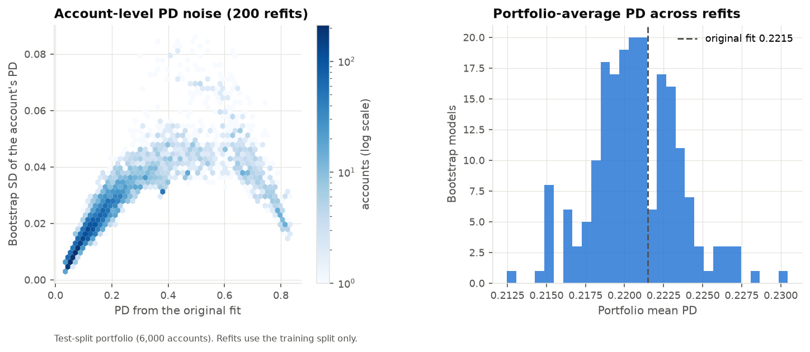
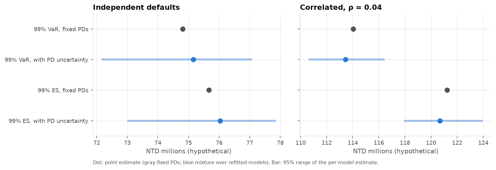
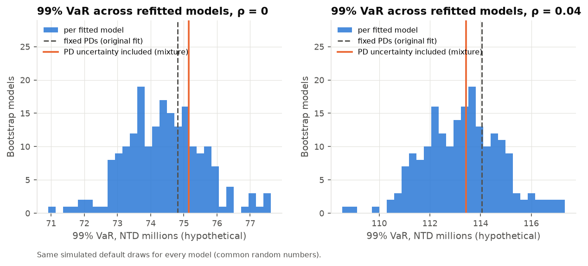
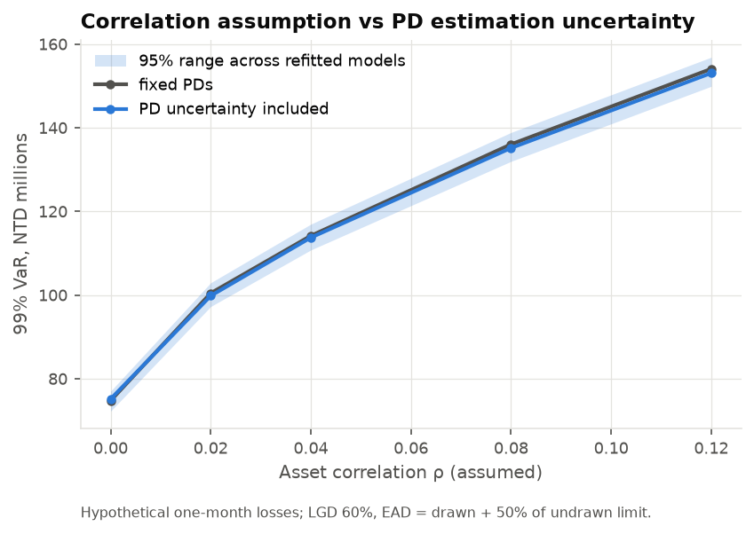
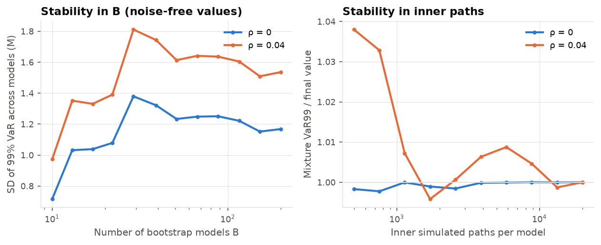

# Research Extension: PD Estimation Uncertainty and the Reliability of Portfolio Tail-Risk Estimates

*Status: **post-hoc, exploratory** (decision D21). Designed and run on 2026-11-20, after every
original CreditLab result, including the test-split metrics, was known. Tables between
`BEGIN`/`END` markers are generated from saved artifacts by `creditlab uncertainty` (and
`creditlab report`); narrative text is hand-written from those tables.*

## Summary

**Question.** How does uncertainty in machine-learning estimates of default probabilities (PDs)
affect the reliability of extreme portfolio credit-loss estimates (VaR and Expected Shortfall)?

**Approach.** Refit the frozen CreditLab model specification on 200 nonparametric bootstrap
resamples of the training split. Score the same 6,000-account test portfolio with each refit, and
run every resulting PD vector through the existing one-factor Monte Carlo engine with common random
numbers. The law of total variance then separates PD-estimation uncertainty from default
randomness.

**Findings** (hypothetical one-month losses, NTD; XGBoost primary model):

1. **Individual PDs are noisy, but the noise mostly cancels at the portfolio level.** The median
   account's PD has a bootstrap SD of 0.022 (13.5% of its value), and 70% of accounts have a 90%
   bootstrap range wider than 5 percentage points. Only about 1% of that variance is a shift shared
   by all accounts, and the shared part is what moves portfolio losses.
2. **The shared shift is mostly sampling noise in the training base rate.** 81% of the variance of
   the refitted portfolio-average PD is explained by the default rate of the bootstrap training
   sample (correlation 0.90).
3. **With independent defaults, estimation uncertainty is comparable to the tail itself.** The 99%
   VaR across refits has a 95% range of 72.2–77.1M (SD 1.17M), against a fixed-PD VaR of 74.8M that
   sits only 4.9M above expected loss. PD estimation contributes 22.6% of total loss variance.
   Almost all of this is expected-loss uncertainty (R² of VaR on EL = 0.999).
4. **With correlated defaults (ρ = 0.04), estimation uncertainty is a small part of the tail.** The
   99% VaR range is 110.6–116.5M (SD 1.54M). In money terms this is similar to the independent case,
   but PD estimation now explains only 0.5% of loss variance; the common factor dominates.
5. **Folding PD uncertainty into a single headline number changes it very little.** Computed
   without Monte Carlo noise, the mixture 99% VaR is +0.4% (independent) and −0.5% (ρ = 0.04) away
   from the fixed-PD value. Both changes are dominated by a −0.42M *bagging shift*: the average
   refitted PD is slightly lower because the refits are slightly weaker (§6.2, §6.4). The
   uncertainty spread on its own adds +0.72M to the independent-case VaR.
6. **The correlation assumption matters far more than PD estimation.** Moving ρ from 0 to 0.12
   raises the 99% VaR from 74.8M to 154.1M, while the estimation band stays about 5–7M wide.

**What this does and does not establish.** These are internal, descriptive results on the same 2005
data as the original study. No new or untouched data was used, and nothing here is an independent
validation. The bootstrap captures training-sample variability only (§8). The bootstrap refits are
also slightly *weaker* than the original fit, so the spread may somewhat overstate the variability
of a full-sample fit (§6.2).

---

## 1. Evaluation status (audit of D9 and D15)

CreditLab's results fall into three tiers, which this document keeps separate:

| Tier | What | Status |
|---|---|---|
| A. Original evaluation | Model selection on validation, then test-split scoring (`results/baseline_v1/`, frozen with SHA-256 checksums) | Frozen. **Not "untouched"**: test metrics were displayed before the D9 rule change |
| B. Post-hoc analyses | Independent review (`docs/INDEPENDENT_REVIEW.md`), this extension | Exploratory; designed after all test results were known |
| C. Independent validation | A new dataset never seen during development | **Does not exist** for this project |

**D9 (calibration rule tightened after test metrics were displayed).** This was audited in
`docs/INDEPENDENT_REVIEW.md` §2.1. Under the old rule the primary model is the same
(`xgboost_raw`), every reported test number is identical, and the change went *against* the test
set: the dropped variant was marginally better on test. The procedural deviation stands, so the
test split is described as "scored after validation-based selection, with one disclosed
deviation", never as untouched (decision D20). There is no version history from that period, so
the order of events rests on the original decision log.

**D15 (Policy B rule changed).** The change was necessary and used only validation data. It does
not affect this extension.

**This extension's own exposure.** It uses the training split for refitting and the test split
only as the portfolio being simulated. **No choice in the extension uses test labels.**
Hyperparameters are the frozen ones, and the B, M and ρ settings were fixed in
`configs/default.yaml` before the full run. Test labels appear only descriptively (observed vs
expected default counts). Because the design was chosen after the original results were known,
the extension is still post-hoc as a whole.

## 2. Motivation

The original risk engine (and most textbook treatments) plugs a point estimate $\hat p_i$ into the
loss model and reports $\mathrm{VaR}_\alpha(\hat p)$ as though $\hat p$ were the truth. But
$\hat p$ comes from a model fitted to 18,000 accounts, and a different sample of 18,000 accounts
would give a different model. A risk number that moves by more than the effect being measured is
not a reliable risk number. The question is therefore not whether ML PDs are uncertain (they
are), but **how much of that uncertainty survives aggregation into portfolio tail measures, and how
it compares with the other assumptions in the loss model.**

## 3. What is established methodology and what is new here

**Established, not invented here:** the nonparametric bootstrap (Efron & Tibshirani, 1993);
Monte Carlo VaR and Expected Shortfall (Glasserman, 2004; Acerbi & Tasche, 2002); the one-factor
Gaussian copula / Vasicek model (Vasicek, 2002; Gordy, 2003); nested simulation for risk
measurement (Gordy & Juneja, 2010); and the idea that PD parameter uncertainty matters for
portfolio credit risk (Löffler, 2003; Tarashev, 2010; Hanson & Schuermann, 2006, on PD confidence
intervals).

**What this project contributes** is an *independent empirical investigation* that applies these
methods to a specific setting:

* PDs from a tuned gradient-boosted tree model (and a logistic baseline), rather than rating-class
  default frequencies, with the entire preprocessing pipeline refitted inside each resample;
* an explicit split of the PD variance into a shared (portfolio-level) part and an account-specific
  part, and a direct link of the shared part to training base-rate sampling;
* common-random-number nested simulation, checked against a noise-free semi-analytic calculation,
  so that the across-model spread can be shown to be real rather than Monte Carlo noise;
* a decomposition of the "uncertainty-adjusted" VaR into a bagging shift and a spread effect;
* sensitivity to algorithmic randomness (seeds) and to re-tuning hyperparameters inside each
  resample, with group-aware folds.

## 4. Method and derivations

### 4.1 Setup

Let $D=\{(x_j,y_j)\}_{j=1}^{N}$ be the training split ($N=18{,}000$). A fitted model
$\hat f = \mathcal{A}(D)$ is the full CreditLab pipeline (feature engineering, encoding, scaling and
classifier) with **frozen hyperparameters**. The test portfolio has $n=6{,}000$ accounts with
covariates $x_i$, PDs $p_i = \hat f(x_i)$ and loss-if-default
$w_i = \mathrm{LGD}\cdot\mathrm{EAD}_i$ (assumed: LGD = 0.6, EAD = drawn balance + 50% of the undrawn
limit). One-month portfolio loss under the one-factor model is

$$
L = \sum_{i=1}^{n} w_i\,\mathbf{1}\{\sqrt\rho\,F + \sqrt{1-\rho}\,\varepsilon_i < \Phi^{-1}(p_i)\},
\qquad F,\varepsilon_i \overset{iid}{\sim} N(0,1).
$$

### 4.2 Outer level: the bootstrap distribution of PD vectors

Draw $D^{*(b)}$, $b=1,\dots,B$, by sampling $N$ rows of $D$ with replacement, and refit
$\hat f^{(b)}=\mathcal{A}(D^{*(b)})$. Each refit yields $p^{(b)}=(\hat f^{(b)}(x_1),\dots,\hat f^{(b)}(x_n))$.
Under the usual bootstrap heuristic, the spread of $p^{(b)}$ around $\hat p$ approximates the
sampling distribution of $\hat p$ around the population-optimal fit for this model class and
these hyperparameters. Every fitted transform lives inside the pipeline, so it is re-estimated on
$D^{*(b)}$; no validation or test row is touched (leakage control).

*Re-tuning variant.* Inside each resample, the randomized hyperparameter search is rerun with
`StratifiedGroupKFold` grouped by account ID. A bootstrap sample contains duplicates, and ordinary
K-fold would place copies of one account in both the fitting and the scoring folds, rewarding
over-fitting.

### 4.3 Inner level: two estimands

For each fitted model, $G_b(\ell)=P(L\le\ell\mid p^{(b)})$ is the loss distribution with PDs held
fixed. Two different questions follow:

1. **Reliability of a reported number:** the distribution of the plug-in estimates
   $\{\mathrm{VaR}_\alpha(G_b)\}_{b=1}^B$. Its spread says how far one analyst's VaR could sit
   from another's with a different training sample.
2. **Risk with uncertainty included:** the equal-weight *mixture*
   $$G_{\text{mix}}(\ell)=\frac1B\sum_{b=1}^{B}G_b(\ell),$$
   which is a bootstrap approximation to the predictive loss distribution that integrates over
   parameter uncertainty. Its VaR and ES are computed from the pooled simulated losses.

These are different objects. In particular $\mathrm{VaR}_\alpha(G_{\text{mix}})$ is **not** the
average of the $\mathrm{VaR}_\alpha(G_b)$.

### 4.4 Separating estimation uncertainty from default randomness

Let $L^{(b)}$ denote a loss drawn from $G_b$ and let $b$ be uniform on $\{1,\dots,B\}$. The law of
total variance gives

$$
\operatorname{Var}(L)=\underbrace{\frac1B\sum_b \operatorname{Var}\!\big(L^{(b)}\big)}_{\text{default randomness}}
+\underbrace{\frac1B\sum_b\big(\mathbb{E}L^{(b)}-\overline{\mathbb{E}L}\big)^2}_{\text{PD estimation}} .
$$

For the empirical mixture of $B$ equal-size blocks of simulated losses, this identity is
**exact** when both terms use population (divide-by-$B$, divide-by-$M$) moments. Using the
$B-1$ divisor inflates the second term by $B/(B-1)$; a unit test caught this during development.
Since $\mathbb{E}L^{(b)}=\sum_i p_i^{(b)}w_i=\mathrm{EL}^{(b)}$, the between-model term can be
checked against the analytic variance of expected loss across models (last column of the
decomposition table).

### 4.5 Why account-level noise cancels

Write $p_i^{(b)}=\bar p_i + c^{(b)} + e_i^{(b)}$, with $c^{(b)}$ the portfolio-average shift in
replicate $b$ and $e_i^{(b)}$ the account-specific remainder. Then

$$
\operatorname{Var}_b\big(\mathrm{EL}^{(b)}\big)=\Big(\sum_i w_i\Big)^2\operatorname{Var}(c)
+\sum_{i}\sum_{k} w_i w_k \operatorname{Cov}(e_i,e_k).
$$

If the remainders were uncorrelated with variance $\sigma_e^2$, the second term would be
$\sigma_e^2\sum_i w_i^2$, of order $n$, while the first is of order $n^2$. Even a shared component
carrying 1% of the per-account variance therefore dominates the uncertainty in portfolio losses.

### 4.6 Why VaR uncertainty tracks EL uncertainty

*Independent defaults.* By the Lyapunov CLT,
$\mathrm{VaR}_\alpha \approx \mathrm{EL} + z_\alpha\sqrt{\sum_i p_i(1-p_i)w_i^2}$. The square-root term
changes little across refits, so $\mathrm{VaR}^{(b)}-\mathrm{VaR}^{(b')}\approx
\mathrm{EL}^{(b)}-\mathrm{EL}^{(b')}$.

*One-factor model.* In the large-portfolio limit,
$\mathrm{VaR}_\alpha\approx\sum_i w_i\,\Phi\!\big((\Phi^{-1}(p_i)+\sqrt\rho\,z_\alpha)/\sqrt{1-\rho}\big)$.
A common upward shift in PDs is amplified by this map, so VaR moves *more* than EL. The map is also
nonlinear in $p_i$, so two PD vectors with the same mean but different cross-sectional dispersion
give different tails (a Jensen effect). Both predictions are checked empirically in §6.6.

### 4.7 Common random numbers and a noise-free reference

All $B$ PD vectors (plus the original fit and the bagged mean) are evaluated on the *same*
$M$ draws of $(F_s,\varepsilon_{is})$. For two models,
$\operatorname{Var}(\hat V_b-\hat V_{b'})=\operatorname{Var}\hat V_b+\operatorname{Var}\hat V_{b'}
-2\operatorname{Cov}(\hat V_b,\hat V_{b'})$, and the covariance is large under common random
numbers, so model differences are estimated far more precisely than by independent runs. The
implementation `simulate_portfolio_multi` reproduces `simulate_portfolio` exactly for each row
(unit-tested), and with fixed PDs it reproduces the original CreditLab scenario numbers to the last
digit.

To show that the across-model spread is not inner Monte Carlo noise, every model is also evaluated
semi-analytically. Conditional on $F$, $L$ is a sum of independent Bernoullis with mean
$m(F)=\sum_i w_i p_i(F)$ and variance $v(F)=\sum_i w_i^2 p_i(F)(1-p_i(F))$, where
$p_i(F)=\Phi\big((\Phi^{-1}(p_i)-\sqrt\rho F)/\sqrt{1-\rho}\big)$. Hence

$$
P(L\le\ell)\approx\int\Phi\!\Big(\frac{\ell-m(F)}{\sqrt{v(F)}}\Big)\,\varphi(F)\,dF ,
$$

evaluated by quadrature on a 4,001-point grid. VaR is found by root-finding, and ES uses the
closed form of $\mathbb{E}(X-q)^+$ for normal $X$. Writing $\hat V_b = V_b + e + d_b$ (with $e$ the
noise common to all models under common random numbers and $d_b$ the model-specific remainder),
$\operatorname{sd}(\hat V_b - V_b^{\text{SA}})$ estimates $\operatorname{sd}(d_b)$.

## 5. Experimental design

| Setting | Value |
|---|---|
| Training data for refits | training split only (18,000 accounts) |
| Portfolio | test split (6,000 accounts); labels used only descriptively |
| Model families | XGBoost (primary) and L2 logistic regression, frozen hyperparameters and raw (uncalibrated) variant, as selected originally |
| Bootstrap refits $B$ | 200 per family (seed `pd_bootstrap`) |
| Seed-only refits | 20 XGBoost refits on the original data with different seeds |
| Re-tuned refits | 20 (same resamples as the first 20 fixed refits; 10 search draws; 3 grouped folds) |
| Inner paths $M$ | 20,000 per model, common random numbers, same seed as the original scenarios |
| Correlation | ρ ∈ {0, 0.04} main; {0, 0.02, 0.04, 0.08, 0.12} grid (10,000 paths) |
| LGD / EAD | 0.60 / drawn + 50% of undrawn (hypothetical, unchanged from the original) |
| Runtime | about 12 minutes on an 8-core laptop (`creditlab uncertainty`) |

## 6. Results

### 6.1 How much do individual PDs move?

<!-- BEGIN:ext_pd -->
| model set | median SD of account PD | 90th pct SD | median relative SD | accounts with 90% range > 0.05 | SD of portfolio mean PD | common share of PD variance |
|---|---|---|---|---|---|---|
| xgboost bootstrap (B = 200) | 0.0216 | 0.0423 | 13.5% | 69.8% | 0.0028 | 1.0% |
| logistic bootstrap (B = 200) | 0.0133 | 0.0306 | 7.2% | 45.2% | 0.0029 | 2.2% |
| xgboost seed only (R = 20) | 0.0051 | 0.0112 | 3.3% | 1.0% | 0.0002 | 0.1% |
| xgboost bootstrap, fixed hyperparameters (first 20) | 0.0213 | 0.0421 | 12.9% | 61.1% | 0.0029 | 1.1% |
| xgboost bootstrap, re-tuned in each sample (20) | 0.0248 | 0.0522 | 16.3% | 69.0% | 0.0030 | 0.8% |
<!-- END:ext_pd -->



Account-level noise is substantial and largest for mid-range PDs (the hump in the left panel).
Algorithmic randomness alone (seed-only refits) is about a quarter of the bootstrap noise and
negligible at the portfolio level (SD of the portfolio-average PD 0.0002 vs 0.0028). Re-tuning
inside each resample raises account-level noise from 0.021 to 0.025 (20 paired replicates).

### 6.2 Refitted models are slightly weaker than the original fit

<!-- BEGIN:ext_models -->
| family | validation AUC, original fit | validation AUC, 95% range across refits | validation log loss, original | validation log loss, 95% range | refit reproduces frozen PDs (max abs diff) |
|---|---|---|---|---|---|
| xgboost | 0.7844 | [0.7776, 0.7837] | 0.4269 | [0.4273, 0.4315] | 0.0e+00 |
| logistic | 0.7718 | [0.7683, 0.7726] | 0.4332 | [0.4330, 0.4360] | 0.0e+00 |
<!-- END:ext_models -->

For XGBoost the entire 95% range of validation AUC across refits lies **below** the original
fit's AUC, and the entire log-loss range lies above it. A bootstrap sample contains only about 63%
distinct accounts, and tree learners respond to duplicates (for example through
`min_child_weight` and row subsampling). The bootstrap therefore describes a slightly
less-informed model than the one actually used, and it may overstate the variability of a
full-sample fit. Logistic regression is much less affected. This caveat applies to every spread
reported below; subsampling without replacement (m-out-of-n) would be a natural cross-check (§9).

### 6.3 Main result: four regimes

<!-- BEGIN:ext_regimes_xgboost -->
| PDs | ρ | EL | VaR 95 | VaR 99 | ES 95 | ES 99 | 95% range of VaR 99 across models | 95% range of ES 99 across models |
|---|---|---|---|---|---|---|---|---|
| fixed (original fit) | 0 | 69.91 | 73.39 | 74.81 | 74.30 | 75.67 | — | — |
| estimation uncertainty (mixture) | 0 | 69.49 | 73.46 | 75.15 | 74.50 | 76.03 | [72.16, 77.08] | [73.00, 77.86] |
| fixed (original fit) | 0.04 | 69.91 | 98.71 | 114.04 | 107.78 | 121.22 | — | — |
| estimation uncertainty (mixture) | 0.04 | 69.49 | 98.15 | 113.43 | 107.25 | 120.67 | [110.62, 116.46] | [117.94, 123.98] |

NTD millions, hypothetical one-month losses (LGD 60%, EAD = drawn + 50% of undrawn). 20,000 common-random-number paths per fitted model.
<!-- END:ext_regimes_xgboost -->




### 6.4 Bagging shift vs genuine spread

<!-- BEGIN:ext_shift -->
| family | ρ | VaR 99 fixed (original fit) | VaR 99 fixed (bagged mean PD) | VaR 99 mixture | bagging shift | spread effect | total change | MC SE of fixed VaR 99 |
|---|---|---|---|---|---|---|---|---|
| xgboost | 0.0 | 74.81 | 74.45 | 75.15 | -0.36 | +0.70 | +0.34 | 0.05 |
| xgboost | 0.04 | 114.04 | 113.71 | 113.43 | -0.34 | -0.27 | -0.61 | 0.59 |
| logistic | 0.0 | 74.88 | 74.86 | 75.63 | -0.02 | +0.77 | +0.75 | 0.06 |
| logistic | 0.04 | 114.46 | 114.47 | 114.47 | +0.01 | +0.00 | +0.01 | 0.65 |

NTD millions. Bagging shift = VaR at the average bootstrap PD minus VaR at the original PDs; spread effect = mixture VaR minus VaR at the average PD. MC SE: batch-means standard error of a single fixed-PD VaR estimate.
<!-- END:ext_shift -->

The Monte Carlo table above shares random draws across rows but still carries simulation noise
(an SE of about 0.6M for a single correlated VaR). The same comparison computed semi-analytically,
with no simulation noise, is:

<!-- BEGIN:ext_shift_noise_free -->
| ρ | VaR 99 fixed | VaR 99 at bagged-mean PD | VaR 99 mixture | bagging shift | spread effect | total change | total change, % | ES 99 spread effect |
|---|---|---|---|---|---|---|---|---|
| 0.0 | 74.78 | 74.36 | 75.08 | -0.42 | +0.72 | +0.30 | +0.40% | +0.84 |
| 0.04 | 114.77 | 114.36 | 114.22 | -0.42 | -0.14 | -0.56 | -0.49% | -0.17 |

NTD millions. Semi-analytic (no Monte Carlo noise): each model's loss CDF by quadrature over the common factor; the mixture CDF is their average.
<!-- END:ext_shift_noise_free -->

The average bootstrap PD is slightly lower than the original fit's PD, consistent with the weaker
refits of §6.2. Evaluating the loss model at that bagged-mean PD moves the 99% VaR by −0.42M in
both regimes. That is a bias of the bootstrap, not risk. The *spread effect* (mixture vs bagged
mean) is +0.72M under independence: mixing distributions whose means differ by about 1.1M (SD)
widens a 2.1M-SD loss distribution. Under correlation the spread effect is small and negative
(−0.14M). Two things contribute. Adding a 1.1M-SD spread to a 16.4M-SD distribution barely moves
its quantiles. And the bagged-mean PD vector is an average of 200 models, so its PDs are less
dispersed than any single model's; §6.6 shows that lower dispersion gives a *larger* correlated
tail, which slightly inflates the reference. Net, folding PD uncertainty into one number changes
the 99% VaR by less than 0.5% in either regime.

### 6.5 Variance decomposition

<!-- BEGIN:ext_decomposition -->
| family | ρ | SD of loss, total | SD from default randomness | SD from PD estimation | PD-estimation share of variance | check: Var of analytic EL across models |
|---|---|---|---|---|---|---|
| xgboost | 0.0 | 2.38 | 2.10 | 1.13 | 22.6% | 22.6% |
| xgboost | 0.04 | 16.43 | 16.39 | 1.13 | 0.5% | 0.5% |
| logistic | 0.0 | 2.39 | 2.08 | 1.17 | 24.1% | 24.2% |
| logistic | 0.04 | 16.59 | 16.55 | 1.17 | 0.5% | 0.5% |

NTD millions.
<!-- END:ext_decomposition -->

The between-model variance from the simulated means agrees with the analytic variance of expected
loss to within 0.1 percentage points.

### 6.6 Mechanism

<!-- BEGIN:ext_mechanism -->
| family | ρ | corr(training default rate, portfolio mean PD) | R² of mean PD on training default rate | R² of VaR 99 on EL | SD(VaR 99) / SD(EL) | residual SD of VaR 99 | corr(residual, PD dispersion) |
|---|---|---|---|---|---|---|---|
| xgboost | 0.0 | 0.900 | 0.810 | 0.999 | 1.03 | 0.031 | -0.54 |
| xgboost | 0.04 | 0.900 | 0.810 | 0.952 | 1.35 | 0.338 | -0.69 |
| logistic | 0.0 | 0.911 | 0.830 | 1.000 | 1.03 | 0.023 | -0.94 |
| logistic | 0.04 | 0.911 | 0.830 | 0.961 | 1.39 | 0.325 | -0.93 |

Across the 200 bootstrap models. VaR values are noise-free semi-analytic; NTD millions. PD dispersion = cross-sectional SD of a model's 6,000 PDs.
<!-- END:ext_mechanism -->

Both predictions of §4.6 hold. Under independence, VaR moves one-for-one with expected loss
(R² ≥ 0.999). Under correlation, VaR moves about 1.35–1.39 times as much as EL, EL still explains
95–96% of its variance, and the remaining variation is negatively associated with PD dispersion:
at the same EL, models with more spread-out PDs give a *smaller* correlated tail. That is the sign
the concavity argument predicts for a portfolio whose PDs mostly lie in the concave region of the
conditional-PD map, but the association is observational across 200 models, not a controlled
experiment.

### 6.7 The correlation assumption dominates

<!-- BEGIN:ext_rho -->
| ρ | VaR 99 fixed | VaR 99, 95% range across models | VaR 99 mixture | ES 99 fixed | ES 99 mixture | PD-estimation share of variance |
|---|---|---|---|---|---|---|
| 0 | 74.77 | [72.26, 77.03] | 75.15 | 75.69 | 76.04 | 22.6% |
| 0.02 | 100.46 | [97.27, 102.95] | 99.84 | 104.79 | 104.31 | 0.9% |
| 0.04 | 114.19 | [110.79, 116.96] | 113.76 | 121.00 | 120.48 | 0.5% |
| 0.08 | 136.05 | [131.98, 138.88] | 135.18 | 146.64 | 145.92 | 0.2% |
| 0.12 | 154.09 | [149.93, 156.87] | 153.09 | 168.25 | 167.43 | 0.2% |

NTD millions; 10,000 paths per model.
<!-- END:ext_rho -->



### 6.8 Sensitivity: seeds and re-tuning

<!-- BEGIN:ext_sensitivity -->
| model set | ρ | models | SD of EL | SD of VaR 99 (semi-analytic) | SD of ES 99 (semi-analytic) | SD of portfolio mean PD |
|---|---|---|---|---|---|---|
| xgboost_seed | 0 | 20 | 0.095 | 0.100 | 0.100 | 0.0002 |
| xgboost_seed | 0.04 | 20 | 0.095 | 0.135 | 0.141 | 0.0002 |
| xgboost_retuned | 0 | 20 | 0.990 | 1.038 | 1.046 | 0.0030 |
| xgboost_retuned | 0.04 | 20 | 0.990 | 1.906 | 2.091 | 0.0030 |
| xgboost_fixed_first_k | 0 | 20 | 0.974 | 1.001 | 1.005 | 0.0029 |
| xgboost_fixed_first_k | 0.04 | 20 | 0.974 | 1.296 | 1.337 | 0.0029 |

NTD millions.
<!-- END:ext_sensitivity -->

Re-tuning hyperparameters inside each resample leaves expected-loss uncertainty unchanged
(0.99M vs 0.97M on the same 20 resamples). However, it raises the SD of the correlated 99% VaR from
1.30M to 1.91M, because different hyperparameters change the *shape* of the PD distribution, which
matters for the correlated tail (§6.6). With only 20 replicates each SD has a relative standard
error of roughly 16%, so this is suggestive, not established. Freezing hyperparameters, as in the
main experiment, likely understates tail uncertainty under correlation.

### 6.9 Logistic regression

<!-- BEGIN:ext_regimes_logistic -->
| PDs | ρ | EL | VaR 95 | VaR 99 | ES 95 | ES 99 | 95% range of VaR 99 across models | 95% range of ES 99 across models |
|---|---|---|---|---|---|---|---|---|
| fixed (original fit) | 0 | 69.99 | 73.43 | 74.88 | 74.33 | 75.65 | — | — |
| estimation uncertainty (mixture) | 0 | 69.94 | 73.91 | 75.63 | 74.97 | 76.52 | [72.40, 77.63] | [73.12, 78.45] |
| fixed (original fit) | 0.04 | 69.99 | 98.93 | 114.46 | 108.23 | 121.82 | — | — |
| estimation uncertainty (mixture) | 0.04 | 69.94 | 98.88 | 114.47 | 108.17 | 121.79 | [111.41, 117.85] | [118.68, 125.22] |

NTD millions, hypothetical one-month losses (LGD 60%, EAD = drawn + 50% of undrawn). 20,000 common-random-number paths per fitted model.
<!-- END:ext_regimes_logistic -->

The picture is the same for the simpler model: almost identical expected-loss uncertainty (both
are driven by the training base rate), smaller account-level noise, and no bagging shift.

### 6.10 Monte Carlo diagnostics and convergence

<!-- BEGIN:ext_mc_noise -->
| ρ | metric | SD across models (Monte Carlo) | SD across models (semi-analytic, noise-free) | model-specific MC noise SD | common MC offset | corr(MC, semi-analytic) |
|---|---|---|---|---|---|---|
| 0.0 | var_95 | 1.157 | 1.158 | 0.018 | +0.046 | 1.000 |
| 0.0 | var_99 | 1.172 | 1.168 | 0.036 | +0.076 | 1.000 |
| 0.0 | es_99 | 1.176 | 1.173 | 0.037 | +0.149 | 1.000 |
| 0.04 | var_95 | 1.420 | 1.421 | 0.060 | -1.046 | 0.999 |
| 0.04 | var_99 | 1.540 | 1.536 | 0.120 | -0.824 | 0.997 |
| 0.04 | es_99 | 1.568 | 1.589 | 0.056 | -1.564 | 0.999 |

NTD millions.
<!-- END:ext_mc_noise -->

The model-specific Monte Carlo noise (0.02–0.12M) is less than 1% of the across-model variance,
so the reported spread is real. The common offset under correlation (about −0.8M for VaR 99) is the
known factor-sample effect of this seed (`docs/INDEPENDENT_REVIEW.md` §3.2). It shifts every model
equally and does not affect the spread.

<!-- BEGIN:ext_convergence -->
| ρ | SD of VaR 99, B = 22 | SD of VaR 99, B = 51 | SD of VaR 99, B = 88 | SD of VaR 99, B = 200 |
|---|---|---|---|---|
| 0 | 1.079 | 1.233 | 1.251 | 1.168 |
| 0.04 | 1.391 | 1.614 | 1.636 | 1.536 |

| ρ | mixture VaR 99 (all paths) | max relative change over the last half of the paths |
|---|---|---|
| 0 | 75.15 | 0.00% |
| 0.04 | 113.43 | 0.13% |

NTD millions. Top: stability of the across-model spread as B grows (noise-free semi-analytic values). Bottom: stability of the mixture VaR as inner paths grow.
<!-- END:ext_convergence -->



The across-model SD settles by B ≈ 50–100. The 2.5% and 97.5% endpoints are each estimated from
roughly five models, so the SDs are the more stable summary of the spread.

### 6.11 Comparison with the original CreditLab findings

<!-- BEGIN:ext_vs_original -->
| scenario | original VaR 99 | extension, fixed PDs (same draws) | noise-free semi-analytic, fixed PDs | 95% range across refitted models | mixture |
|---|---|---|---|---|---|
| base | 74.81 | 74.81 | 74.78 | [72.16, 77.08] | 75.15 |
| base_correlated | 114.04 | 114.04 | 114.77 | [110.62, 116.46] | 113.43 |

NTD millions.
<!-- END:ext_vs_original -->

<!-- BEGIN:ext_defaults -->
Observed test defaults: 1,327. Expected under the original fit: 1,328.9; 95% range across refitted models: [1,290.2, 1,360.1]. Descriptive only.
<!-- END:ext_defaults -->

The extension leaves the original conclusions intact and qualifies them:

* *Original:* "correlation, not the PD model, drives the tail." **Confirmed and quantified:**
  across ρ ∈ [0, 0.12] the correlation assumption moves the 99% VaR by about 79M, while PD
  estimation moves it by about ±2.4–3.5M.
* *Original:* "under independent defaults the 99% VaR is only 7% above EL." **Qualified:** that
  margin (4.9M) is of the same order as the 95% estimation range of the VaR itself (4.9M wide).
  Read in isolation, the fixed-PD VaR understates the uncertainty in this regime.
* *Original:* "the PDs are well calibrated in the large." **Consistent:** the observed 1,327 test
  defaults lie inside the refits' 95% range of expected defaults.

## 7. Answer to the research question

For this portfolio, PD estimation uncertainty from finite training data:

* **does matter** for the *reliability* of tail estimates when defaults are close to independent,
  where it is comparable in size to the tail margin itself;
* **matters little** once defaults share even a weak common factor, where it is under 1% of loss
  variance;
* **acts mainly through the portfolio-average PD**, which is in turn driven mostly by base-rate
  sampling in the training data, not by the account-level instability of the ML model;
* **changes the headline VaR very little** when folded into a mixture distribution (under 0.5%,
  computed without simulation noise); and
* is **an order of magnitude smaller than the uncertainty from the correlation assumption**, which
  the data cannot estimate.

A practical reading: the most useful single addition to a fixed-PD VaR on this kind of portfolio
is an interval for expected loss, which can be obtained cheaply from the training base rate. More
elaborate bootstrap machinery adds little unless the correlation and LGD/EAD assumptions are first
pinned down.

## 8. What bootstrapping clients does not capture

The bootstrap resamples the 18,000 historical clients we have. It measures how much the fitted
model would change with a different sample **from the same population, period and data-collection
process**. It says nothing about:

* **distribution shift:** later periods, different economic conditions, or a portfolio drawn
  differently from the 2005 sample;
* **missing variables:** income, other debts and macro conditions are absent from the data, and
  resampling cannot recover what was never measured;
* **selection bias:** only existing, approved cardholders appear; nothing about applicants or
  reject inference;
* **missing historical periods:** one outcome month gives no way to estimate correlation, PD
  dynamics or through-the-cycle behaviour;
* **model-specification and model-selection uncertainty**, except partially through the re-tuning
  sensitivity;
* **LGD and EAD uncertainty**, which are fixed assumptions here.

A wider interval from the bootstrap is therefore a *lower bound* on real-world uncertainty, not a
complete account of it.

## 9. Limitations and unresolved concerns of the extension

* **Post-hoc and same data.** Designed after all original results were known; uses the same
  training and test accounts. Exploratory, not confirmatory.
* **Bootstrap refits are weaker than the original fit (§6.2),** so the spread may be somewhat
  overstated and the bagged mean shifted. An m-out-of-n subsampling check was not run.
* **Hyperparameters frozen** in the main experiment; the 20-replicate re-tuning check suggests this
  understates correlated-tail uncertainty.
* **Calibration not propagated.** The frozen choice was the uncalibrated model, so no calibrator was
  refitted. A calibrated primary model would need group-aware calibration folds inside each
  resample (not implemented; the code refuses rather than silently skipping it).
* **Percentile endpoints** rest on about five models each.
* **Semi-analytic reference** uses a conditional normal approximation, which slightly understates
  right-tail skew (about 0.1–0.2M at ES 99 under independence).
* **The same factor draws as the original scenarios** were used deliberately, for exact
  comparability. This also carries over the seed's factor-sample bias of about −0.7% on correlated
  tails.
* **All money figures inherit the original limitation** that the default label is a missed
  payment, not a write-off (`docs/INDEPENDENT_REVIEW.md` §6, weakness 1).

## 10. Reproduce

```bash
source .venv/bin/activate
creditlab uncertainty            # ~12 min; writes artifacts/metrics/uncertainty/ and figures
creditlab report                 # regenerates the tables in this document
pytest tests/test_uncertainty.py
```

Fast smoke run (writes only to `artifacts/_fast/`): `creditlab uncertainty --config configs/fast.yaml`.

## References

* Acerbi, C. & Tasche, D. (2002). On the coherence of expected shortfall. *Journal of Banking & Finance*, 26(7).
* Efron, B. & Tibshirani, R. (1993). *An Introduction to the Bootstrap*. Chapman & Hall.
* Glasserman, P. (2004). *Monte Carlo Methods in Financial Engineering*. Springer.
* Gordy, M. (2003). A risk-factor model foundation for ratings-based bank capital rules. *Journal of Financial Intermediation*, 12(3).
* Gordy, M. & Juneja, S. (2010). Nested simulation in portfolio risk measurement. *Management Science*, 56(10).
* Hanson, S. & Schuermann, T. (2006). Confidence intervals for probabilities of default. *Journal of Banking & Finance*, 30(8).
* Löffler, G. (2003). The effects of estimation error on measures of portfolio credit risk. *Journal of Banking & Finance*, 27(8).
* Tarashev, N. (2010). Measuring portfolio credit risk correctly: Why parameter uncertainty matters. *Journal of Banking & Finance*, 34(9).
* Vasicek, O. (2002). The distribution of loan portfolio value. *Risk*, 15(12).
* Yeh, I.-C. (2009). Default of Credit Card Clients [Dataset]. UCI Machine Learning Repository. https://doi.org/10.24432/C55S3H
