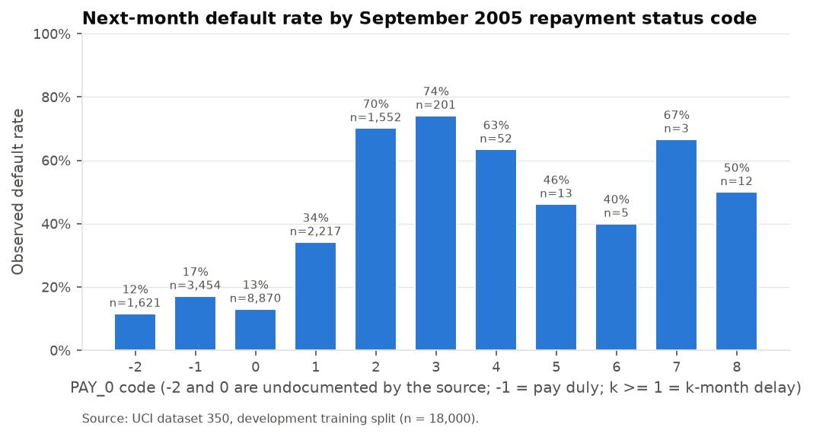
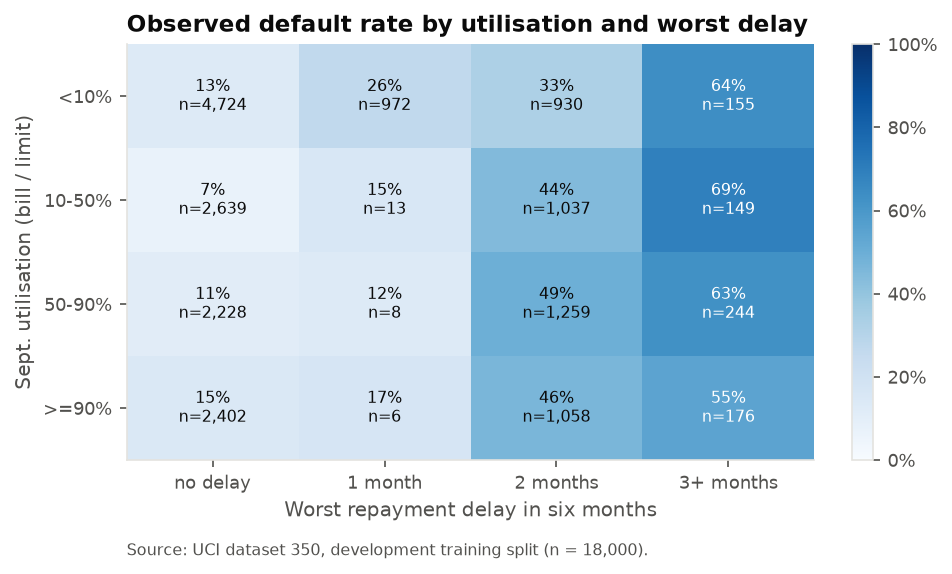
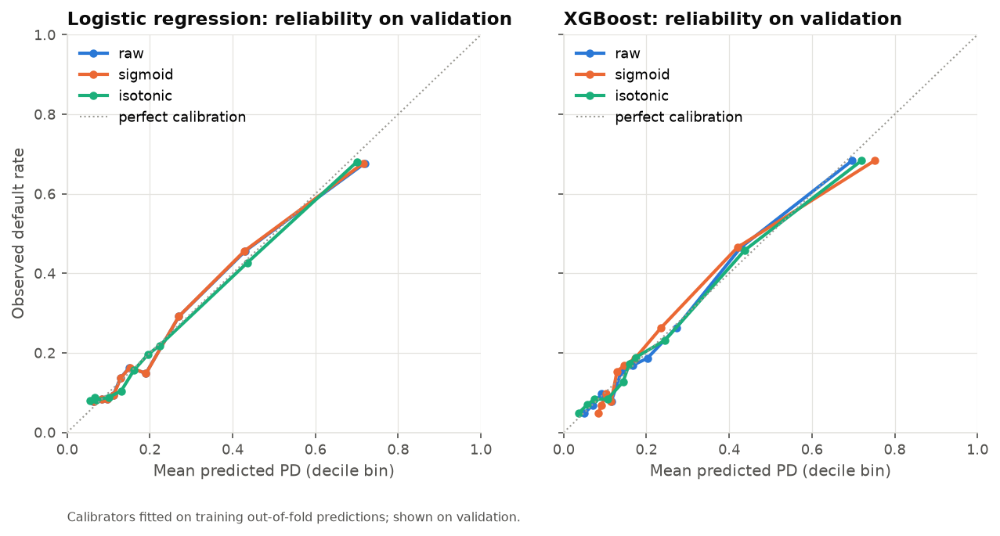
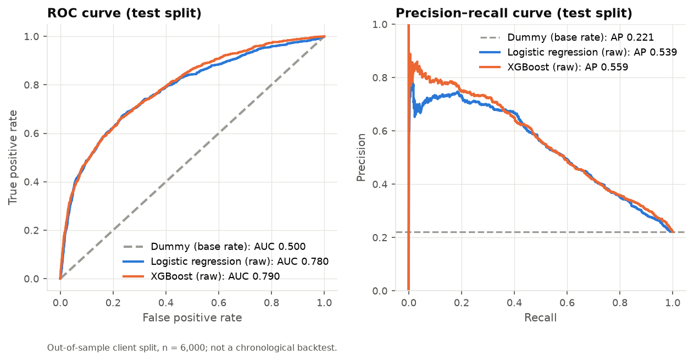
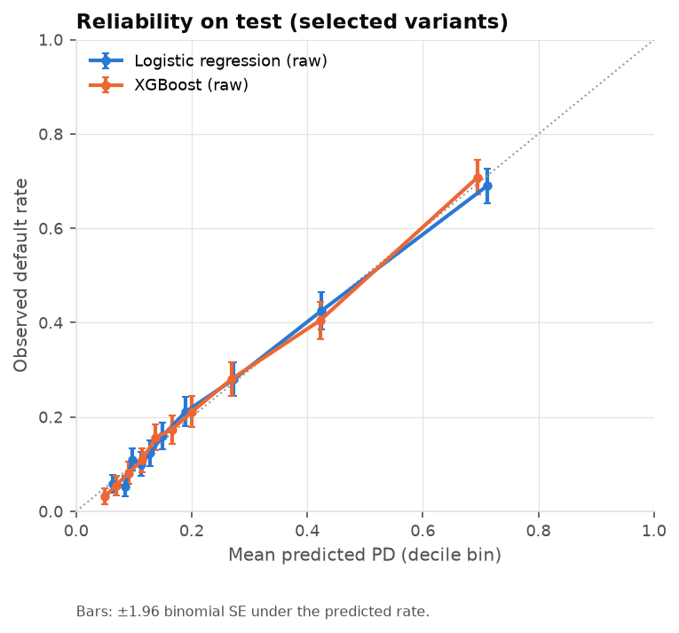
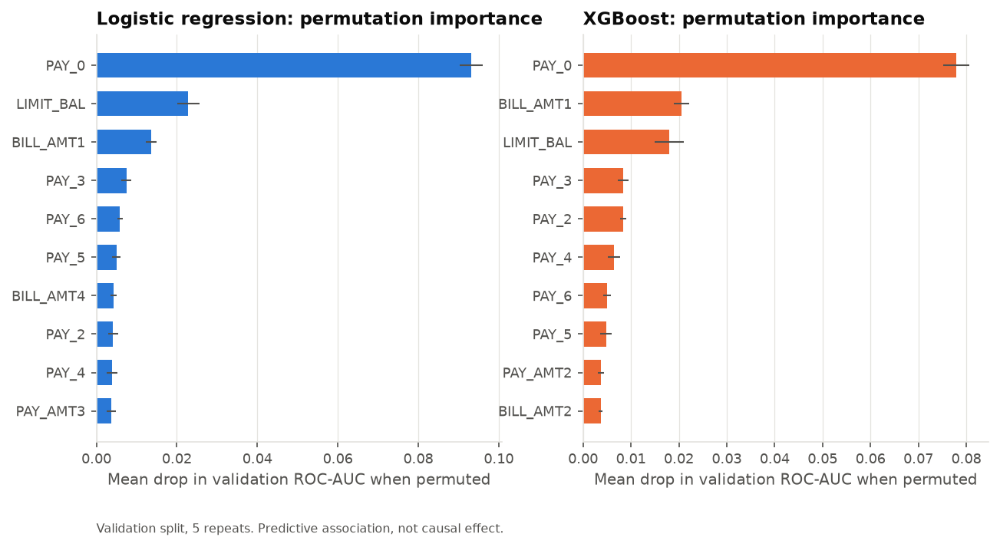
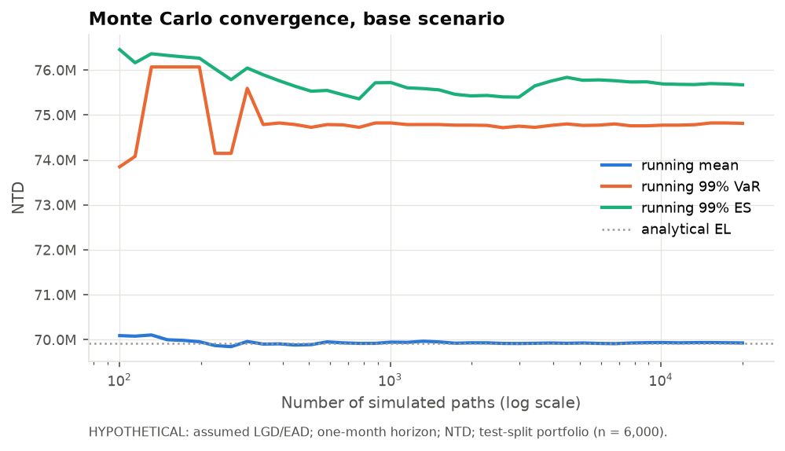
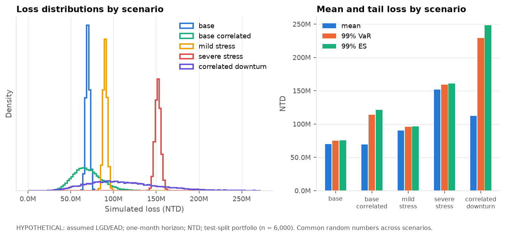
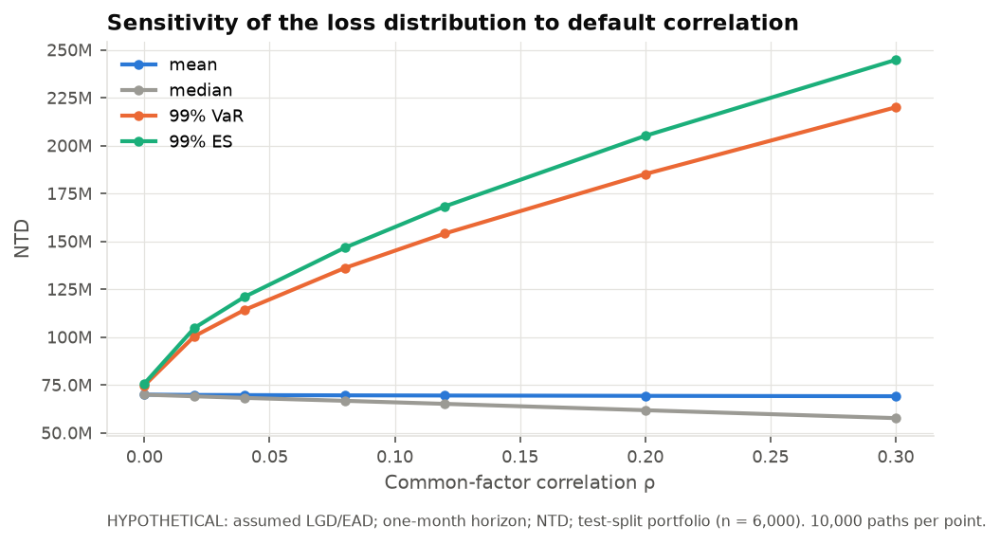
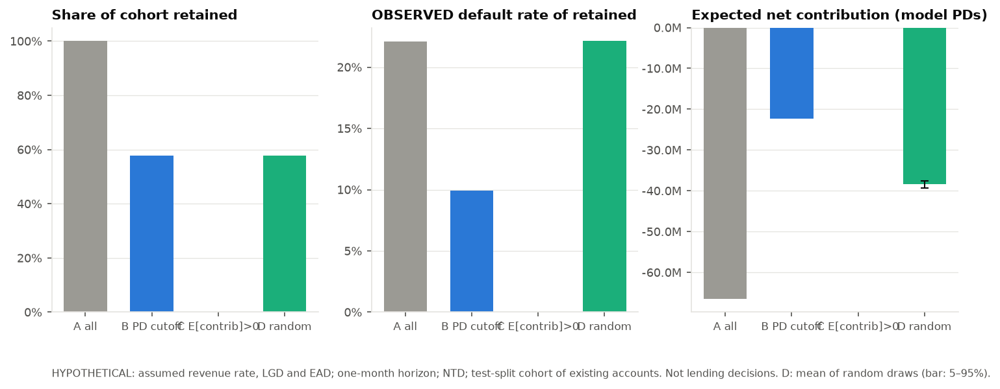

# CREDITLAB: Credit Default Modeling, Portfolio Stress Testing and Decision Research

*Research report. All tables between `BEGIN`/`END` markers are regenerated from saved artifacts by
`creditlab report`. Figures are in `docs/figures/` (copied from `artifacts/figures/`).*

## Abstract

Using the UCI *Default of Credit Card Clients* dataset (30,000 Taiwanese cardholders, 2005), we
estimate the probability that an existing account defaults on its next monthly payment. We then
trace how those probabilities propagate into hypothetical portfolio-loss distributions and
hypothetical selection policies.

Model selection used a strict train/validation/test protocol. On the untouched test split,
gradient-boosted trees (XGBoost) reached ROC-AUC 0.790 (95% bootstrap CI 0.777–0.804) against
0.780 for an L2 logistic regression; the paired difference was +0.010 (CI +0.004 to +0.016). Both
models were already well calibrated. Sigmoid and isotonic recalibration, fitted on training
out-of-fold predictions, did not produce a validation improvement distinguishable from zero, so
the raw models were kept.

Applying assumed loss-given-default and exposure parameters to the test cohort gives a
hypothetical one-month expected loss of NTD 69.9M. Under independent defaults the 99% VaR is only
7% above EL. A one-factor Gaussian dependence of ρ = 0.04 raises it to NTD 114M while leaving the
mean unchanged. A hypothetical PD-cutoff policy chosen on validation retained 57.9% of the test
cohort with an observed default rate of 9.9%, compared with 22.1% for random cohorts of the same
size. Under one-month economics, no account had positive expected contribution at plausible
margins. That is a consequence of the horizon and the sample's 22% default rate, not a business
finding.

---

## 1. Research motivation

Credit-risk practice depends less on classifying defaulters than on producing *probabilities*
that can be aggregated into losses, capital and decisions. This project asks four linked
questions:

1. How well can next-month default be predicted from six months of account history, without
   sensitive attributes?
2. Are the predicted probabilities calibrated well enough to be used as PDs?
3. What do those PDs imply for a portfolio's loss distribution under explicit, hypothetical LGD,
   EAD, stress and dependence assumptions?
4. How do simple model-based selection rules compare, and what can and cannot be concluded from
   such comparisons on observational data?

## 2. Dataset and provenance

UCI Machine Learning Repository dataset 350 (Yeh, 2009; DOI 10.24432/C55S3H; CC BY 4.0),
downloaded with `ucimlrepo`. The stored copy is read-only and hash-verified, and its content is
identical to the official CSV (`data/raw/uci_350_provenance.json`). Validation confirmed:
30,000 rows, 23 features, unique IDs, no missing values, and a binary target.

<!-- BEGIN:dataset -->
| split | accounts | observed defaults | default_rate |
|---|---|---|---|
| train | 18000 | 3982 | 0.2212 |
| validation | 6000 | 1327 | 0.2212 |
| test | 6000 | 1327 | 0.2212 |

Total: 30,000 accounts, 23 source features, observed default rate 0.2212 (6,636 defaults).
<!-- END:dataset -->

Data anomalies were documented rather than "fixed" (`docs/DATA_DICTIONARY.md`). Repayment-status
codes -2 and 0, which are undocumented, make up 66.9% of month-records. Code 1 appears for 12% of
accounts in September but almost never earlier. 1,930 accounts have a credit balance in some
month, and 21 groups of identical feature vectors carry conflicting labels.

Exploratory SQL (DuckDB, `sql/analysis.sql`) ran on the training split only. The September status
code separates risk sharply: codes -2, -1 and 0 default at 12–17%, a one-month delay at 34%, and a
two-month delay at 70%. Default rates fall from 36% in the lowest credit-limit decile to 12% in the
highest.

## 3. Problem formulation

$\mathrm{PD}_i = P(Y_i=1\mid X_i)$, where $Y_i$ is the *observed* default label and $X_i$ contains
only information recorded before the outcome month. The split is a stratified 60/20/20 split at
the client level. Because all accounts share one observation window, the test result measures
generalisation to *other clients of the same period*. **It is not a chronological backtest.**

## 4. Statistical modelling methodology

All preprocessing lives inside scikit-learn pipelines fitted on the training split. The
engineered features are row-wise, so they learn nothing across rows. Models:

- **Baseline:** predicts the training default rate for everyone.
- **Logistic regression:** one-hot status codes, signed-log + standardised amounts, L2 penalty.
  Grid over $C$ and class weights, 5-fold training CV.
- **XGBoost:** raw ordinal codes and amounts, 30-draw randomized search over depth, learning rate,
  trees, `min_child_weight`, subsampling, $\lambda$ and `scale_pos_weight`, 5-fold training CV.

Selection criterion: **log loss**, a proper scoring rule, because the probabilities feed the risk
engine. Class re-weighting left CV ROC-AUC essentially unchanged but worsened CV log loss sharply:
0.557 vs 0.432 for logistic, 0.523 vs 0.425 for XGBoost. This is the expected
probability distortion, so unweighted models were chosen.

<!-- BEGIN:hyperparameters -->
| model | selected hyperparameters | CV log loss | CV ROC-AUC | candidates |
|---|---|---|---|---|
| logistic_raw | C=0.1, class_weight=None | 0.4319 | 0.7776 | 10 |
| xgboost_raw | subsample=0.7, scale_pos_weight=1.0, reg_lambda=20.0, n_estimators=200, min_child_weight=5, max_depth=5, learning_rate=0.02, colsample_bytree=0.8 | 0.4253 | 0.7863 | 30 |
<!-- END:hyperparameters -->

## 5. Validation and calibration

**Protocol.** (1) Tuning by training CV. (2) Calibrators fitted on training out-of-fold scores.
(3) On *validation*: choose each family's calibration variant, the primary model and F1
thresholds, then write `selection.json`. (4) Load the test split, verify the leakage checks
(training-ID hash, disjointness), and score it once. Automated tests confirm the training hash,
that reported metrics recompute exactly from saved predictions, and that the saved models
reproduce those predictions.

Validation metrics for every candidate:

<!-- BEGIN:validation_all -->
| model | roc_auc | average_precision | brier | log_loss | ece | calibration_intercept | calibration_slope |
|---|---|---|---|---|---|---|---|
| dummy_raw | 0.5000 | 0.2212 | 0.1723 | 0.5284 | 0.0001 | — | — |
| logistic_raw | 0.7718 | 0.5397 | 0.1354 | 0.4332 | 0.0198 | -0.0603 | 0.9680 |
| logistic_sigmoid | 0.7718 | 0.5397 | 0.1354 | 0.4332 | 0.0198 | -0.0494 | 0.9771 |
| logistic_isotonic | 0.7710 | 0.5263 | 0.1355 | 0.4385 | 0.0125 | -0.0801 | 0.9486 |
| xgboost_raw | 0.7844 | 0.5554 | 0.1338 | 0.4269 | 0.0137 | 0.0119 | 1.0250 |
| xgboost_sigmoid | 0.7844 | 0.5554 | 0.1346 | 0.4298 | 0.0302 | -0.0544 | 0.9756 |
| xgboost_isotonic | 0.7834 | 0.5420 | 0.1342 | 0.4283 | 0.0178 | -0.0701 | 0.9593 |
<!-- END:validation_all -->

Paired bootstrap of calibrated − raw on validation:

<!-- BEGIN:calibration_bootstrap -->
| comparison (validation) | metric | mean difference | 95% CI |
|---|---|---|---|
| logistic_sigmoid - logistic_raw | brier | -0.00000 | [-0.00004, +0.00003] |
| logistic_sigmoid - logistic_raw | log_loss | -0.00004 | [-0.00014, +0.00006] |
| logistic_isotonic - logistic_raw | brier | +0.00009 | [-0.00037, +0.00052] |
| logistic_isotonic - logistic_raw | log_loss | +0.00476 | [-0.00122, +0.01630] |
| xgboost_sigmoid - xgboost_raw | brier | +0.00073 | [+0.00015, +0.00129] |
| xgboost_sigmoid - xgboost_raw | log_loss | +0.00284 | [+0.00088, +0.00479] |
| xgboost_isotonic - xgboost_raw | brier | +0.00041 | [+0.00003, +0.00080] |
| xgboost_isotonic - xgboost_raw | log_loss | +0.00142 | [+0.00040, +0.00255] |
<!-- END:calibration_bootstrap -->

<!-- BEGIN:selection -->
| family | chosen variant | qualifying calibrations | F1 threshold |
|---|---|---|---|
| logistic | raw | none | 0.2635 |
| xgboost | raw | none | 0.2866 |

Primary model (lowest validation log loss): **xgboost_raw**.
<!-- END:selection -->

**Interpretation.** The logistic model is fitted by maximum likelihood with an intercept, so it is
calibrated in-the-large on training data by construction. The tuned XGBoost (shallow trees, slow
learning rate, strong $\lambda$) was also already close to calibrated: its test calibration slope is
1.04 and its ECE 0.013. Sigmoid scaling changed logistic log loss by −0.00004 (CI includes 0).
Isotonic regression created ties, lowering average precision by about 0.013. Both methods
*worsened* XGBoost. Calibration is therefore not assumed to help. An earlier version of the
selection rule (log loss lower and Brier not higher) picked logistic + sigmoid on a negligible
gain. The rule was tightened to require a bootstrap-supported improvement *before* any downstream
analysis; see `docs/DECISIONS.md` D9.

## 6. Results: discrimination and calibration on the test split

<!-- BEGIN:test_metrics -->
| model | ROC-AUC | AUC 95% CI | PR-AUC (AP) | AP 95% CI | Brier | log loss | accuracy @0.5 |
|---|---|---|---|---|---|---|---|
| dummy_raw | 0.5000 | [0.5000, 0.5000] | 0.2212 | [0.2103, 0.2317] | 0.1723 | 0.5284 | 0.7788 |
| logistic_raw | 0.7799 | [0.7658, 0.7941] | 0.5389 | [0.5116, 0.5675] | 0.1355 | 0.4322 | 0.8197 |
| xgboost_raw | 0.7899 | [0.7765, 0.8042] | 0.5592 | [0.5303, 0.5887] | 0.1335 | 0.4244 | 0.8215 |
<!-- END:test_metrics -->

<!-- BEGIN:test_difference -->
| metric | difference (XGBoost − logistic) | paired bootstrap 95% CI |
|---|---|---|
| roc_auc | +0.0100 | [+0.0039, +0.0161] |
| average_precision | +0.0205 | [+0.0068, +0.0338] |
| brier | -0.0020 | [-0.0032, -0.0008] |
| log_loss | -0.0079 | [-0.0114, -0.0044] |
<!-- END:test_difference -->

<!-- BEGIN:threshold_metrics -->
| model | threshold (from validation) | precision | recall | F1 | accuracy | flagged | TN | FP | FN | TP |
|---|---|---|---|---|---|---|---|---|---|---|
| logistic_raw | 0.2635 | 0.5016 | 0.5870 | 0.5410 | 0.7797 | 0.259 | 3899 | 774 | 548 | 779 |
| xgboost_raw | 0.2866 | 0.5252 | 0.5494 | 0.5370 | 0.7905 | 0.231 | 4014 | 659 | 598 | 729 |
| dummy_raw | 0.2212 | 0.2212 | 1.0000 | 0.3622 | 0.2212 | 1.000 | 0 | 4673 | 0 | 1327 |
<!-- END:threshold_metrics -->

The dummy model reaches 77.9% accuracy at a 0.5 threshold with zero ranking ability, which is why
accuracy is not used for selection. At the validation-chosen threshold XGBoost flags 23% of test
accounts and catches 55% of defaulters with 53% precision.

Both models rely mostly on the September repayment status. Credit limit and the latest bill come
next. Importance is measured as the drop in validation AUC when a feature is permuted, and it is
predictive, not causal:

<!-- BEGIN:importance -->
| model | feature | auc_drop_mean | auc_drop_std |
|---|---|---|---|
| logistic_raw | PAY_0 | 0.0932 | 0.0028 |
| logistic_raw | LIMIT_BAL | 0.0229 | 0.0027 |
| logistic_raw | BILL_AMT1 | 0.0135 | 0.0013 |
| logistic_raw | PAY_3 | 0.0075 | 0.0012 |
| logistic_raw | PAY_6 | 0.0058 | 0.0007 |
| logistic_raw | PAY_5 | 0.0049 | 0.0011 |
| xgboost_raw | PAY_0 | 0.0779 | 0.0027 |
| xgboost_raw | BILL_AMT1 | 0.0206 | 0.0017 |
| xgboost_raw | LIMIT_BAL | 0.0180 | 0.0031 |
| xgboost_raw | PAY_3 | 0.0084 | 0.0011 |
| xgboost_raw | PAY_2 | 0.0084 | 0.0007 |
| xgboost_raw | PAY_4 | 0.0065 | 0.0012 |
<!-- END:importance -->

## 7. Risk model assumptions

Only PD is modelled from data. LGD = 60% and EAD = drawn balance + 50% of the undrawn limit are
**hypothetical** (`docs/ASSUMPTIONS.md`). Horizon one month; currency NTD; portfolio = the 6,000
test accounts with out-of-sample PDs from the primary model.

<!-- BEGIN:expected_loss -->
| quantity | value |
|---|---|
| Accounts (test split) | 6,000 |
| Model | xgboost_raw |
| Assumed LGD | 60% |
| Assumed EAD | max(BILL_AMT1, 0) + CCF * max(LIMIT_BAL - max(BILL_AMT1, 0), 0) (CCF = 0.5) |
| Hypothetical total EAD (NTD) | 644.35M |
| Hypothetical total EL (NTD) | 69.91M |
| EL / EAD | 0.1085 |
| Mean PD | 0.2215 |
| EAD-weighted PD | 0.1808 |
| Expected defaults (Σ PD) | 1328.9 |
| Observed defaults in test split | 1,327 |
| Assumed LGD/EAD applied to observed defaults (NTD) | 72.46M |
| Share of EL in top 10% of accounts by EL | 0.391 |
| Share of EL / EAD in top PD decile | 0.268 / 0.071 |
<!-- END:expected_loss -->

The EAD-weighted PD (0.181) is below the mean PD (0.221): riskier accounts tend to have smaller
exposures. The model's expected default count (1,328.9) matches the observed 1,327 test defaults
closely, a calibration-in-the-large check.

<!-- BEGIN:risk_bands -->
| band | n_accounts | mean_pd | observed_default_rate | share_of_accounts | share_of_ead | share_of_el |
|---|---|---|---|---|---|---|
| [0.0, 0.05) | 298 | 0.044 | 0.034 | 0.050 | 0.091 | 0.022 |
| [0.05, 0.1) | 1423 | 0.074 | 0.060 | 0.237 | 0.317 | 0.127 |
| [0.1, 0.2) | 2167 | 0.145 | 0.150 | 0.361 | 0.340 | 0.265 |
| [0.2, 0.35) | 969 | 0.255 | 0.262 | 0.162 | 0.119 | 0.168 |
| [0.35, 0.5) | 451 | 0.413 | 0.395 | 0.075 | 0.052 | 0.120 |
| [0.5, 1.0) | 692 | 0.672 | 0.685 | 0.115 | 0.082 | 0.298 |
<!-- END:risk_bands -->

Within every PD band the observed default rate is close to the mean predicted PD. The top band
(PD ≥ 0.5) holds 11.5% of accounts but 29.8% of expected loss.

## 8. Monte Carlo methodology

20,000 paths per scenario, vectorised in chunks of 1,000 accounts × paths (measured peak-memory increase ≈ 125 MB for 6,000 accounts), with a fixed seed
and common random numbers across scenarios. Defaults follow the one-factor Gaussian model
$Z_i=\sqrt\rho F+\sqrt{1-\rho}\,\varepsilon_i$ with default if $Z_i<\Phi^{-1}(\mathrm{PD}_i)$; ρ = 0 is
the independent case. VaR is the lower empirical quantile. ES uses the tie-correct
Acerbi–Tasche / Rockafellar–Uryasev estimator (`docs/MATHEMATICS.md` §8–9).

Verified properties (tests):
- simulated marginal default frequencies match input PDs within binomial error for ρ ∈ {0, 0.15, 0.4};
- the independent mean and variance match their closed forms;
- the default-count variance matches the bivariate-normal formula;
- large-portfolio quantiles match the Vasicek formula within 5%;
- fixed seeds reproduce results, and results do not depend on chunk size;
- ES ≥ VaR, including on heavily tied distributions.

## 9. Results: scenarios and tail risk

<!-- BEGIN:scenarios -->
| scenario | odds × | LGD | ρ | mean PD | analytical EL | MC mean | median | std | VaR 95 | VaR 99 | ES 95 | ES 99 |
|---|---|---|---|---|---|---|---|---|---|---|---|---|
| base | 1.0 | 0.6 | 0.0 | 0.2215 | 69.91M | 69.93M | 69.90M | 2.10M | 73.39M | 74.81M | 74.30M | 75.67M |
| base_correlated | 1.0 | 0.6 | 0.04 | 0.2215 | 69.91M | 69.60M | 68.22M | 16.48M | 98.71M | 114.04M | 107.78M | 121.22M |
| mild_stress | 1.5 | 0.6 | 0.0 | 0.2811 | 90.36M | 90.37M | 90.35M | 2.32M | 94.20M | 95.83M | 95.22M | 96.68M |
| severe_stress | 2.5 | 0.75 | 0.0 | 0.3688 | 151.93M | 151.95M | 151.93M | 3.21M | 157.24M | 159.42M | 158.61M | 160.68M |
| correlated_downturn | 1.5 | 0.75 | 0.12 | 0.2811 | 112.95M | 112.09M | 107.00M | 41.88M | 188.19M | 229.44M | 212.81M | 248.45M |

20,000 paths per scenario; NTD.
<!-- END:scenarios -->

Diagnostics. The independent scenarios' simulated means lie within 1 SE of analytical EL. The
correlated scenarios lie about 2.7–2.9 SE below it, which this seed's factor sample explains
(mean $z=+2.47$; positive $F$ means fewer defaults). Repeating the correlated setting with
independent seeds shows no bias:

<!-- BEGIN:mc_unbiasedness -->
Unbiasedness check (correlated_downturn, 30 independent seeds × 2,000 paths): standardised error (MC mean − analytical EL)/SE has mean +0.03 and SD 1.18; share with |z| > 2: 0.03 (≈0.05 expected for an unbiased estimator).
<!-- END:mc_unbiasedness -->

<!-- BEGIN:scenario_checks -->
| scenario | mean_minus_el_in_se | factor_sample_mean_z | var_99_mc_se | es_99_mc_se | max_abs_marginal_pd_error | P(L > 1.1× base EL) | P(L > 1.25× base EL) | P(L > 1.5× base EL) | P(L > 2.0× base EL) |
|---|---|---|---|---|---|---|---|---|---|
| base | +0.81 | — | 0.05M | 0.09M | 0.0117 | 0.0008 | 0.0000 | 0.0000 | 0.0000 |
| base_correlated | -2.69 | +2.47 | 0.59M | 0.72M | 0.0133 | 0.3056 | 0.1439 | 0.0255 | 0.0003 |
| mild_stress | +0.73 | — | 0.06M | 0.09M | 0.0137 | 1.0000 | 0.9011 | 0.0000 | 0.0000 |
| severe_stress | +0.89 | — | 0.11M | 0.12M | 0.0119 | 1.0000 | 1.0000 | 1.0000 | 1.0000 |
| correlated_downturn | -2.88 | +2.47 | 1.56M | 1.94M | 0.0165 | 0.7920 | 0.6944 | 0.5197 | 0.2361 |
<!-- END:scenario_checks -->

The observed number of test defaults falls in the middle of the simulated default-count
distribution:

<!-- BEGIN:observed_vs_simulated -->
| scenario | observed defaults | simulated mean | simulated 95% interval | share of paths below observed |
|---|---|---|---|---|
| base | 1327 | 1329.2 | [1274, 1386] | 0.464 |
| base_correlated | 1327 | 1323.7 | [822, 1931] | 0.531 |
<!-- END:observed_vs_simulated -->

## 10. Sensitivity analysis

**Correlation.** Raising ρ leaves the mean essentially unchanged (differences are factor-sampling
noise) and increases VaR/ES steeply. It also *lowers* the median, so the effect of ρ is not
monotone across quantiles.

<!-- BEGIN:rho_sensitivity -->
| rho | mean | median | std | var_99 | es_99 |
|---|---|---|---|---|---|
| 0.0 | 69.94M | 69.91M | 2.10M | 74.77M | 75.69M |
| 0.02 | 69.75M | 69.04M | 11.75M | 100.46M | 104.79M |
| 0.04 | 69.68M | 68.21M | 16.52M | 114.19M | 121.00M |
| 0.08 | 69.55M | 66.69M | 23.41M | 136.05M | 146.64M |
| 0.12 | 69.45M | 65.10M | 28.81M | 154.09M | 168.25M |
| 0.2 | 69.27M | 61.79M | 37.57M | 185.12M | 205.09M |
| 0.3 | 69.09M | 57.65M | 46.69M | 219.98M | 244.75M |
<!-- END:rho_sensitivity -->

**LGD and EAD.** EL is exactly linear in LGD and increasing in CCF. The EAD assumption matters as
much as the PD model: across the grid, EL ranges from NTD 12.9M to 155.5M.

<!-- BEGIN:el_sensitivity -->
| ead_method | CCF or limit fraction | LGD 30% | LGD 60% | LGD 90% |
|---|---|---|---|---|
| balance_plus_ccf | 0.0 | 18.09 | 36.18 | 54.27 |
| balance_plus_ccf | 0.25 | 26.52 | 53.05 | 79.57 |
| balance_plus_ccf | 0.5 | 34.96 | 69.91 | 104.87 |
| balance_plus_ccf | 0.75 | 43.39 | 86.78 | 130.17 |
| balance_plus_ccf | 1.0 | 51.82 | 103.65 | 155.47 |
| limit_fraction | 0.25 | 12.86 | 25.73 | 38.59 |
| limit_fraction | 0.5 | 25.73 | 51.45 | 77.18 |
| limit_fraction | 0.75 | 38.59 | 77.18 | 115.77 |
| limit_fraction | 1.0 | 51.45 | 102.91 | 154.36 |

Values in NTD millions.
<!-- END:el_sensitivity -->

<!-- BEGIN:lgd_sensitivity -->
| lgd | rho | mean | var_99 | es_99 |
|---|---|---|---|---|
| 0.3 | 0.0 | 34.97M | 37.38M | 37.84M |
| 0.3 | 0.04 | 34.84M | 57.09M | 60.50M |
| 0.6 | 0.0 | 69.94M | 74.77M | 75.69M |
| 0.6 | 0.04 | 69.68M | 114.19M | 121.00M |
| 0.9 | 0.0 | 104.90M | 112.15M | 113.53M |
| 0.9 | 0.04 | 104.52M | 171.28M | 181.50M |
<!-- END:lgd_sensitivity -->

## 11. Hypothetical decision-policy experiments

Cohort: the 6,000 test accounts, all existing cardholders. "Retain" means inclusion in a
hypothetical cohort. A: retain all. B: retain if PD < cutoff, where the cutoff is the largest one
whose retained *validation* accounts have an observed default rate ≤ 10% (an assumed risk
appetite). C: retain if expected one-month contribution > 0. D: random cohorts the size of B.

<!-- BEGIN:policy_threshold -->
Rule `max_bad_rate` (target observed bad rate 0.1). Selected PD cutoff **0.1748** on validation; validation observed bad rate 0.0996; validation share retained 0.579. Break-even analysis (test): share of accounts with positive expected one-month contribution at r = 0.015: 0.000; highest account break-even PD 0.0244 vs lowest model PD 0.0353; median break-even monthly revenue rate 0.298 (539 accounts have no drawn balance).
<!-- END:policy_threshold -->

<!-- BEGIN:policy -->
| policy | share_selected | mean_pd | observed_default_rate | total_ead | total_expected_loss | total_expected_revenue | expected_net_contribution | realized_hypothetical_contribution | share_el_top10pct_accounts | loss_var_99_rho_0.04 |
|---|---|---|---|---|---|---|---|---|---|---|
| A_retain_all | 1.000 | 0.221 | 0.221 | 644.35M | 69.91M | 3.49M | -66.42M | -69.04M | 0.391 | 113.03M |
| B_pd_threshold | 0.579 | 0.102 | 0.099 | 446.16M | 24.95M | 2.70M | -22.25M | -20.89M | 0.268 | 49.48M |
| C_expected_contribution | 0.000 | — | — | 0.00M | 0.00M | 0.00M | 0.00M | 0.00M | — | 0.00M |
| D_random_equal_size | 0.579 | 0.221 | 0.221 | 372.84M | 40.43M | 2.02M | -38.41M | -39.92M | 0.391 | 65.92M |

Policy D: mean of 1000 random draws. 5–95% range of observed default rate: [0.214, 0.228]; of expected net contribution: [-39.30M, -37.53M].
<!-- END:policy -->

At equal size, B's retained cohort has an **observed** default rate of 9.9%, against 22.1% for
random cohorts (5–95% range 21.4–22.8%). Its hypothetical EL and 99% VaR are also far lower. This
is the clearest evidence of the model's ranking value. Policy C retains nobody: one month of
margin cannot offset a one-off LGD × EAD loss at these PDs. It starts retaining accounts only at
monthly revenue rates of 6% or more, which are implausible and shown only to illustrate the
mechanics.

<!-- BEGIN:policy_revenue -->
| monthly_revenue_rate | A_retain_all | B_pd_threshold | C_expected_contribution | D_random_equal_size |
|---|---|---|---|---|
| 0.005 | 1.0 | 0.578 | 0.0 | 0.578 |
| 0.015 | 1.0 | 0.578 | 0.0 | 0.578 |
| 0.03 | 1.0 | 0.578 | 0.0 | 0.578 |
| 0.06 | 1.0 | 0.578 | 0.051 | 0.578 |
| 0.12 | 1.0 | 0.578 | 0.269 | 0.578 |
| 0.25 | 1.0 | 0.578 | 0.43 | 0.578 |
<!-- END:policy_revenue -->

**What cannot be concluded.** These comparisons use outcomes observed under the bank's actual 2005
treatment of each account. They do not show what would have happened under a different policy,
they involve no applicants, and the money figures rest on assumed economics. They are not profit
improvements or lending recommendations.

## 12. Limitations and ethical considerations

The full list is in `docs/LIMITATIONS.md`. The central issues:

- **Selection bias.** Existing accounts only, with limits set by past decisions.
- **No out-of-time validation.**
- **Undocumented codes.**
- **Hypothetical financials.** No observed LGD, EAD or revenue.
- **Gaussian-copula and fixed-PD assumptions** in the tails.

Sensitive attributes were excluded, yet group differences remain. Mean predicted PD differs from
the observed rate by −0.018 for men and +0.012 for women. Discrimination is lower for the 50+ age
band (AUC 0.755) than for 30–39 (0.800). Policy B would retain 62.7% of the graduate-education
group but 50.8% of the high-school group.

<!-- BEGIN:audit -->
| attribute | group | n | observed_default_rate | mean_predicted_pd | predicted_minus_observed | roc_auc |
|---|---|---|---|---|---|---|
| SEX | 1 male | 2378 | 0.251 | 0.233 | -0.018 | 0.782 |
| SEX | 2 female | 3622 | 0.202 | 0.214 | +0.012 | 0.794 |
| AGE_BAND | 21-29 | 1981 | 0.230 | 0.239 | +0.010 | 0.792 |
| AGE_BAND | 30-39 | 2172 | 0.202 | 0.207 | +0.004 | 0.800 |
| AGE_BAND | 40-49 | 1280 | 0.223 | 0.215 | -0.008 | 0.784 |
| AGE_BAND | 50+ | 567 | 0.261 | 0.232 | -0.029 | 0.755 |
| EDUCATION | 1 graduate | 2138 | 0.206 | 0.194 | -0.012 | 0.810 |
| EDUCATION | 2 university | 2814 | 0.228 | 0.233 | +0.005 | 0.782 |
| EDUCATION | 3 high school | 959 | 0.248 | 0.254 | +0.006 | 0.773 |
| EDUCATION | other/undocumented (0,4,5,6) | 89 | 0.079 | 0.169 | +0.090 | — |
| MARRIAGE | 1 married | 2723 | 0.235 | 0.222 | -0.013 | 0.797 |
| MARRIAGE | 2 single | 3192 | 0.211 | 0.220 | +0.009 | 0.786 |
| MARRIAGE | other/undocumented (0,3) | 85 | 0.141 | 0.257 | +0.116 | — |
<!-- END:audit -->

<!-- BEGIN:policy_audit -->
| attribute | group | n | share_selected_B_pd_threshold | share_selected_C_expected_contribution |
|---|---|---|---|---|
| SEX | 1 male | 2378 | 0.551 | 0.000 |
| SEX | 2 female | 3622 | 0.596 | 0.000 |
| AGE_BAND | 21-29 | 1981 | 0.537 | 0.000 |
| AGE_BAND | 30-39 | 2172 | 0.620 | 0.000 |
| AGE_BAND | 40-49 | 1280 | 0.590 | 0.000 |
| AGE_BAND | 50+ | 567 | 0.541 | 0.000 |
| EDUCATION | 1 graduate | 2138 | 0.627 | 0.000 |
| EDUCATION | 2 university | 2814 | 0.563 | 0.000 |
| EDUCATION | 3 high school | 959 | 0.508 | 0.000 |
| EDUCATION | other/undocumented (0,4,5,6) | 89 | 0.652 | 0.000 |
| MARRIAGE | 1 married | 2723 | 0.581 | 0.000 |
| MARRIAGE | 2 single | 3192 | 0.580 | 0.000 |
| MARRIAGE | other/undocumented (0,3) | 85 | 0.471 | 0.000 |
<!-- END:policy_audit -->

## 13. Conclusions and future work

On this dataset, six months of repayment history predicts next-month default with moderate
discrimination (AUC ≈ 0.79). The predictions are well calibrated without post-hoc calibration.
XGBoost's advantage over logistic regression is small but statistically supported. Translating
PDs into money depends at least as much on the assumed LGD, EAD and default dependence as on the
model: correlation, not the PD model, drives the tail.

Future work:
- propagate PD estimation uncertainty into VaR/ES (bootstrap the model, then simulate);
- t-copula or multi-factor dependence;
- stochastic and PD-correlated LGD;
- multi-month horizons with account dynamics;
- a fairness analysis against explicit criteria;
- external validation on another period or portfolio, which is the most important gap.
